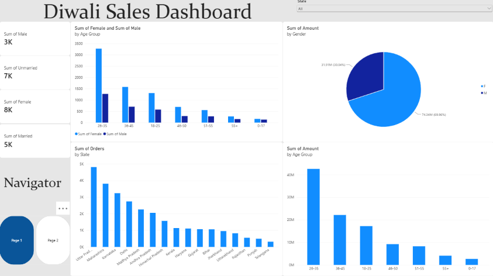
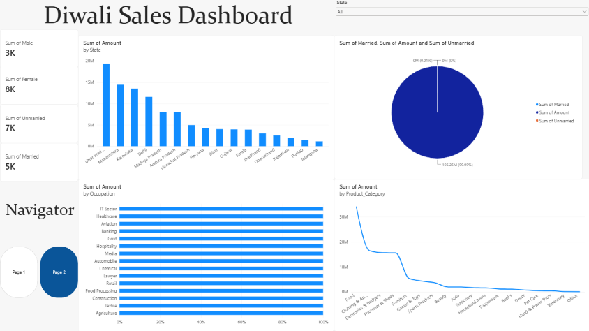

# 🪔 Diwali Sales Dashboard

An interactive **Diwali Sales Dashboard** built using Power BI to analyze customer demographics, sales performance, purchasing behavior, and product categories. This project provides valuable insights into customer segmentation and sales trends through interactive data visualizations.

## 📊 Dashboard Preview

### Page 1: Customer Demographics & Sales Analysis



### Page 2: Sales Performance Analysis



## 🎯 Project Objectives

- Analyze customer demographics based on gender, age group, marital status, and occupation.
- Understand sales distribution across different states.
- Identify the age groups contributing the most to total sales.
- Examine customer purchasing patterns.
- Analyze sales performance across product categories.
- Develop an interactive dashboard for data-driven decision-making.

## 🛠️ Tools & Technologies

- **Power BI** – Dashboard development and data visualization
- **Power Query** – Data cleaning and transformation
- **DAX** – Calculated measures and business metrics
- **Data Visualization** – Bar charts, pie charts, and line charts

## 📈 Dashboard Features

### Page 1: Customer Demographics & Sales Analysis

- **Gender Analysis:** Visualizes customer distribution and sales by gender.
- **Age Group Analysis:** Compares male and female customers across different age groups.
- **Gender-wise Sales:** Displays the contribution of each gender to total sales.
- **State-wise Orders:** Compares order volumes across states.
- **Age Group Sales:** Identifies the age groups contributing the most to total sales.
- **KPI Cards:** Summarizes customer metrics, including gender and marital status.

### Page 2: Sales Performance Analysis

- **State-wise Sales:** Compares total sales amounts across different states.
- **Marital Status Analysis:** Displays metrics related to marital status and sales.
- **Occupation-wise Analysis:** Explores sales distribution across customer occupations.
- **Product Category Analysis:** Visualizes sales amounts across different product categories.
- **Interactive State Filter:** Enables users to filter the dashboard by state.

## 🔍 Key Insights

- **Gender Distribution:** Female customers account for a larger share of the customer base and sales amount than male customers.
- **Age Group Performance:** Customers aged 26–35 contribute the highest sales amount among the displayed age groups.
- **State-wise Performance:** Sales and order volumes vary across different states.
- **Customer Segmentation:** The dashboard enables comparisons based on age, gender, marital status, and occupation.
- **Occupation Analysis:** Sales can be explored across different professional categories.
- **Product Category Analysis:** The visualizations help identify product categories with higher and lower sales amounts.

## ⚙️ Interactive Features

- State-level filtering.
- Two-page dashboard navigation.
- Interactive data visualizations.
- KPI cards for quick performance summaries.
- Comparative analysis of customer segments.
- Dynamic filtering across dashboard visuals.

## 📂 Project Structure

```text
Diwali-Sales-Dashboard/
│
├── README.md
├── Page1.png
├── Page2.png
├── Diwali_Sales_Dashboard.pbix
└── dataset.csv
